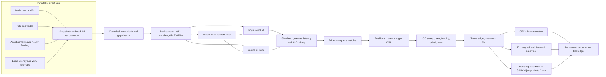

# Hyperliquid Dual-Engine Bot: Institutional Backtesting, Stress Testing, and Robustness Framework

## Executive answer

The correct research stack is a **causal, discrete-event exchange emulator**, not a bar backtester. It should rebuild Hyperliquid’s price-time-priority book from an opening snapshot plus ordered per-order diffs, inject each simulated action only after sampled decision, network, and exchange latency, and send every resulting fill through the same position, risk, fee, funding, and WAL state machines used in production. Hyperliquid officially matches orders in price-time priority; its current write-priority mechanism can also reorder newly placed ALO orders within a 400 ms eligibility window, so queue placement cannot be reduced to “displayed size at signal time.”[^1][^2]

Historical and synthetic testing should be complementary. Historical event replay is the primary estimator of realizable execution; regime-conditioned stationary bootstrap tests alternative historical orderings; and a hidden semi-Markov, GARCH/copula, jump model probes unobserved tail paths. Parameter selection should target a broad out-of-sample plateau under nested purged validation—not the highest cell in a heatmap—and should report the complete trial count, Deflated Sharpe Ratio (DSR), Probability of Backtest Overfitting (PBO), tail drawdown, and execution degradation.[^3][^4][^5]

A critical implementation correction is that Hyperliquid funding is **paid hourly**, although its formula is expressed on an eight-hour basis and divided by eight for each hourly payment. The replay engine must therefore apply funding at every actual hourly timestamp rather than charging a single eight-hour lump sum.[^6]

## Research principles

Five invariants should govern the platform:

- **One event clock:** market data, strategy decisions, order submissions, acknowledgements, book changes, trades, funding, and risk actions share one monotonic ordering key.
- **No synthetic certainty:** exact L4 history produces exact historical queue placement; L2-only history produces an uncertainty distribution, not a fabricated queue position.
- **Causal state:** every feature at time `t` uses only messages received by `t`; snapshots from the future, retrospective HMM smoothing, revised candles, and post-fill information are forbidden.
- **Identical accounting:** historical replay, bootstraps, and synthetic paths use the same portfolio mutex, partial-fill logic, fees, funding, margin, liquidation, stop, and WAL semantics.
- **Fold-local calibration:** HMM, O-U, volatility, fill, cancellation, latency, jump, copula, and duration parameters are estimated only from each training fold.

## Data foundation

Hyperliquid’s official archive exposes L2 book snapshots and asset contexts, while node data includes fills by block; the official documentation also recommends recording additional datasets where needed. For current production-grade replay, the preferred source is the node-level raw book-diff tape combined with a compatible book snapshot. The official `order_book_server` consumes fills, order statuses, and raw book diffs, exposes an L4 snapshot-plus-diff stream, and continuously checks its reconstructed state against node snapshots.[^7][^8]

The following hierarchy is recommended:

| Rank | Data surface | Use | Limitation |
|---|---|---|---|
| 1 | Snapshot + `node_raw_book_diffs_by_block` + fills + order statuses | Exact per-order queue reconstruction and event replay | Large storage and decoding burden; coverage must be audited |
| 2 | Self-recorded L4 stream from a local node/order-book server | Forward research and live/backtest parity | No history before recording began |
| 3 | Official L2 snapshots + node fills | OBI, depth, spread, and conservative fill envelopes | Aggregated levels do not identify cancellation position or exact FIFO rank |
| 4 | Candles only | Macro HMM/O-U research and rough signal screening | Not admissible for execution P&L |

A book cannot be reconstructed from diffs alone: it needs a state seed followed by strictly ordered updates. Available archival catalogs document raw per-order diffs and snapshot seeds, and warn that raw diffs without a known starting state are insufficient. Each replay partition should therefore carry `coin`, block height, intra-block index, exchange timestamp, receive timestamp when available, event type, order ID, owner/address if available, side, price ticks, size lots, priority metadata, and a schema version.[^9][^10]

### Integrity gates

Before a day enters research, require:

- A snapshot at or before the replay start.
- Continuous sequence or block linkage with no duplicate ordering keys.
- Reconstructed level totals equal checkpoint snapshots within exact decimal arithmetic.
- Fills reconcile to removals/size reductions and trade IDs.
- Tick size and lot-size transitions are versioned.
- Asset contexts include oracle price and the funding observation used at each hourly charge.
- Gaps are marked **untradable**; never forward-fill a book across a missing interval.

Public WebSocket L2 subscriptions provide book snapshots and trades, with 5 levels in fast mode or 20 in slow mode; WebSocket clients must also handle disconnects and recover missed data. This is adequate for live monitoring and a fallback recorder, but order-level replay should use L4/node outputs whenever possible.[^11][^12]

## Discrete-event architecture

The event kernel should be deterministic for a fixed input tape and random seed. A practical Rust topology is a single-threaded deterministic matching/accounting actor fed by decoded partitions, with CPU-heavy model estimation outside the event loop; `tokio` may perform I/O, but it should not determine event ordering. Persist a hash of input manifests, configuration, code commit, random seed, and output ledger for every run.

### Event ordering

For equal or nearly equal timestamps, process according to venue order rather than arbitrary host order. A safe hierarchy is:

1. Apply exchange events in canonical block/intra-block order.
2. Deliver market messages to the strategy after sampled read latency.
3. Evaluate timers and finalized candles.
4. Write the simulated intent to the WAL.
5. Deliver placement/cancel/IOC after sampled write latency and priority adjustment.
6. Apply exchange acknowledgement/rejection.
7. Run matching, accounting, fees, funding, and risk callbacks.

This makes stale-view risk explicit: the strategy decides from the book it has received, while matching occurs against the book at exchange arrival.

## Queue-aware maker fills

### Exact L4 model

For a newly acknowledged order `o` at price `p`, define its initial volume ahead as

\[
Q^{\mathrm{ahead}}_o(t_{ack}) = \sum_{j \in \mathcal{Q}(p,t_{ack}):\,j \prec o} q_j,
\]

where `j \prec o` is the venue’s realized queue ordering. Hyperliquid uses price-time priority, but current ALO priority can reorder the tail of a level for 400 ms; raw diffs expose an `insertBefore` field that the official order-book server uses to preserve this ordering.[^2][^1]

At each event:

\[
Q^{\mathrm{ahead}}_{t+}=\max\!\left(0,Q^{\mathrm{ahead}}_t-C^{\mathrm{ahead}}_t-M_t\right),
\]

where `C^{ahead}` is cancellation or modification volume known to be ahead and `M` is contra-aggressor volume executed at the order’s price. Once `Q^{ahead}` reaches zero, residual eligible trade volume partially fills the simulated size. A print strictly through a resting bid or ask implies that all eligible liquidity at that better price was exhausted, subject to correct event ordering and the assumption that the simulated order is too small to alter the historical path.

A **touch is not a fill**. A maker buy at 100 fills only after sell-aggressor volume at 100 consumes all volume ahead, or after a sell executes below 100; analogous logic applies to a maker sell. This is consistent with queue-reactive models, which treat limit additions, cancellations, and market-order consumption as distinct events whose intensities depend on book state.[^13][^14]

### L2 uncertainty model

When only level totals are available, exact cancellation rank is unidentified. Maintain a latent queue position and run at least three calibrated policies:

| Policy | Cancellation treatment | Interpretation |
|---|---|---|
| Conservative | Same-price cancellations reduce volume behind first | Lower-bound fill rate |
| Pro-rata hazard | Cancellation reduces `Q_ahead` by a fitted ahead probability | Central estimate |
| Optimistic | Same-price cancellations reduce volume ahead first | Upper-bound fill rate |

The central model may use

\[
C^{\mathrm{ahead}}_t = C_t\,\rho(x_t), \qquad
\operatorname{logit}\rho(x_t)=\beta_0+\beta^\top x_t,
\]

with features such as relative queue percentile, order age, level depth, spread, OBI, recent cancellation intensity, and volatility. Fit `rho` against periods where L4 truth exists, separately by asset, side, depth bucket, and regime. Report all strategy results across the three policies; do not hide the queue uncertainty inside a single fill haircut.

### Market-impact boundary

Historical replay is valid only while the simulated order is small relative to local depth and flow. Define participation diagnostics such as

\[
\pi^{book}_t=\frac{q_o}{Q_p(t)}, \qquad
\pi^{flow}_{\Delta}=\frac{q_o}{V^{contra}_{\Delta}(p)}.
\]

Runs that exceed predeclared thresholds should be rerun in an endogenous queue-reactive simulator or receive a capacity warning. The queue-reactive literature models the LOB as a continuous-time Markov jump system conditional on queue sizes and is suitable for transaction-cost simulation when historical-path invariance no longer holds.[^15][^16]

## Adverse selection

Adverse selection should emerge from the same replay path, not from an arbitrary post-fill penalty. For a passive fill at price `p_f`, define the signed adverse markout at horizon `h` as

\[
A_h = s\,(p_f-m_{t+h}),
\]

where `s=+1` for a buy, `s=-1` for a sell, and positive `A_h` is adverse. Record 100 ms, 1 s, 5 s, 30 s, and strategy-horizon markouts, plus whether the best quote depleted immediately after the fill.

Estimate the conditional distribution

\[
A_h\mid(\mathrm{OBI},\Delta\mathrm{OBI},\text{spread},\text{depth},\text{trade sign},
\text{volatility},P_C,P_T,P_S,\text{latency},\text{queue percentile}).
\]

Passive fills are mechanically dependent on subsequent price movement, and treating fills as independent of price dynamics understates pick-off risk. Liquidity imbalance can help predict adverse flow, but its value degrades with cancellation latency; this directly supports replaying cancellation acknowledgements rather than assuming instantaneous quote withdrawal.[^17][^18]

For synthetic LOB tests, use a state-dependent queue-reactive Hawkes process:

\[
\lambda_e(t)=\phi_e(Q_t,X_t)+\sum_{e'}\int_0^t \alpha_{ee'}e^{-\beta_{ee'}(t-u)}\,dN_{e'}(u),
\]

where event types cover adds, cancels, and market orders by side/level. Hawkes augmentation improves the representation of clustered order flow relative to a pure queue-reactive process.[^16]

## OBI replay

For levels `1...L`, define weighted book imbalance

\[
I_t^{(L)}=
\frac{\sum_{\ell=1}^{L} w_\ell B_{\ell,t}-\sum_{\ell=1}^{L}w_\ell A_{\ell,t}}
{\sum_{\ell=1}^{L} w_\ell B_{\ell,t}+\sum_{\ell=1}^{L}w_\ell A_{\ell,t}},
\qquad w_\ell=e^{-\gamma(\ell-1)}.
\]

Update an event-time EWMA with the actual inter-arrival duration:

\[
E_t^{(\tau)}=e^{-\Delta t/\tau}E_{t^-}^{(\tau)}+
\left(1-e^{-\Delta t/\tau}\right)I_t^{(L)}.
\]

Use raw `I_t` for “instant,” and `tau` values matching 250 ms, 1 s, and 5 s for the remaining scales. This avoids the distortion caused by treating irregular book events as evenly spaced samples.

Anti-lookahead requirements are strict:

- Seed from the last snapshot at or before the partition start and replay every ordered diff.
- Compute OBI only after the event that changes the book; a decision at that event may use the updated state only if production receives that update before deciding.
- Build 1-minute and 15-minute candles from trades in event time; release a close only after finalization plus observed processing latency.
- Use HMM **forward-filtered** probabilities, never full-sample smoothed probabilities.
- Carry EWMA/HMM/O-U warm-up state from training or a pre-test burn-in, but never fit parameters on test observations.
- Abort or quarantine any interval with a sequence gap.

## Latency and execution costs

### Latency model

Split total latency into observable components:

\[
L^{place}=L^{decision}+L^{sign}+L^{uplink}+L^{mempool}+L^{block},
\]

\[
L^{cancel}=L^{decision}+L^{sign}+L^{uplink}+L^{cancel\_priority}+L^{block},
\]

and separately model market-data staleness. Fit empirical distributions by hour, congestion, asset, action type, payload size, and priority setting from production telemetry. Preserve dependence between read and write latency during congestion using paired resampling or a copula.

Hyperliquid’s current order-priority rules matter materially. IOC priority changes end-to-end ordering over the 0–8 bps range and can order high-priority IOCs within roughly 70 ms buckets; ALO priority can reorder orders placed within 400 ms and charges on resting notional even if the order never fills. These mechanisms must be scenario inputs, with priority gas booked as a cost.[^2]

### IOC exits

At simulated exchange arrival, sweep the ask for a buy-to-cover or the bid for a sell-to-close, level by level:

\[
\bar p_{IOC}=\frac{\sum_\ell p_\ell q_\ell}{\sum_\ell q_\ell},
\qquad
\mathrm{slippage}=s\left(\frac{\bar p_{IOC}}{m_{decision}}-1\right).
\]

Respect the actual IOC limit. A 0.5% tolerance is not a guarantee of completion: if depth inside the limit is insufficient, leave the residual position open, trigger the production retry/escalation logic, and continue exposure and funding. Hyperliquid explicitly returns an IOC cancellation when no resting liquidity can be matched.[^19]

### Fees

Compute fees fill by fill:

\[
\mathrm{fee}_i=|q_i p_i|\,f_i,
\]

where `f_i` is determined by maker/taker status, rolling 14-day weighted volume, staking tier, referral state, asset mode, and any maker-rebate tier. Hyperliquid currently assesses fee tiers from rolling 14-day volume; base perp rates range by volume tier, and maker rebates can reach negative 0.003% for qualifying maker share.[^20]

Do not hard-code one rate for an entire multi-month run. The preferred hierarchy is actual historical account fee state, a path-dependent tier engine, then fixed low/base/high fee scenarios. Include priority gas separately from trading fees.

### Funding

At each hourly funding timestamp `u`, apply

\[
\mathrm{FundingPnL}_u=-s\,q_u\,O_u\,F_u,
\]

where `s=+1` for long and `-1` for short, `q_u` is position size, `O_u` is oracle price, and `F_u` is the hourly rate. Hyperliquid computes an eight-hour rate from average premium plus a clamped interest component, pays one eighth hourly, and uses position size times oracle price for the payment.[^6]

Use the historical funding series in event replay. In synthetic tests, model funding jointly with basis, OBI, and regime; independently shuffling funding destroys the carry/trend relationship that matters to Engine B.

## Monte Carlo design

No single Monte Carlo model is sufficient. Use three layers and require conclusions to agree across them.

### Historical stationary bootstrap

Resample synchronized multi-asset event blocks, not independent bars. The stationary bootstrap draws blocks of geometrically distributed length, preserving local dependence while allowing boundaries at any point.[^21][^22]

Recommended procedure:

1. Build synchronized blocks containing returns, LOB features, trades, funding, spreads, and cross-asset state.
2. Stratify starting points by inferred regime and time-of-day.
3. Draw a block length with a data-driven mean based on dependence decay; sensitivity-test half and double that mean.
4. Concatenate blocks with a short burn-in for recursive filters.
5. Replay the complete strategy and execution stack.

This is the most defensible non-parametric test of changed regime ordering, but it cannot create shocks or dependence structures absent from history.

### Semi-Markov regimes

A standard HMM implies geometrically distributed state durations, which is often too restrictive; a hidden semi-Markov model (HSMM) models duration explicitly. For regime `z`, use a negative-binomial duration:[^23]

\[
D_z\sim 1+\operatorname{NegBin}(r_z,p_z),
\qquad E[D_z]=1+r_z\frac{1-p_z}{p_z}.
\]

After `D_z` bars, draw the next state from a transition matrix with a zero diagonal. Estimate transition probabilities and duration distributions in each training fold. Stress them by scaling trend and consolidation mean durations by `{0.5, 0.75, 1.0, 1.5, 2.0}` while separately multiplying `T→S` hazard by `{1, 2, 4}`.

### Regime-switching jump model

A practical four-asset return model is

\[
r_{i,t}=\mu_{i,z_t}\Delta t-\frac{1}{2}h_{i,t}\Delta t+
\sqrt{h_{i,t}\Delta t}\,\varepsilon_{i,t}+
\sum_{k=1}^{N_{i,t}}J_{i,t,k},
\]

\[
N_{i,t}\sim\operatorname{Poisson}(\lambda_{i,z_t}\Delta t),
\qquad J_{i,t,k}\sim\mathcal{N}(\mu^J_{i,z_t},(\sigma^J_{i,z_t})^2).
\]

Merton’s construction superimposes Poisson-driven lognormal jumps on geometric Brownian diffusion and is a useful transparent baseline. Replace constant variance with regime-dependent GJR-GARCH:[^24][^25]

\[
h_{i,t}=\omega_{i,z_t}+\alpha_{i,z_t}\epsilon_{i,t-1}^2+
\gamma_{i,z_t}\mathbf{1}_{\{\epsilon_{i,t-1}<0\}}\epsilon_{i,t-1}^2+
\beta_{i,z_t}h_{i,t-1}.
\]

Generate cross-asset innovations and jump indicators with a state-conditioned Student-t copula. Regime-switching copula-GARCH models capture changing tail dependence that a Gaussian or time-invariant dependence model can average away. Calibrate margins robustly, winsorize nothing in tail estimation, and compare parametric tails with empirical residual and EVT alternatives.[^26]

### Full experiment

For each of 10,000 independent 30-day paths:

1. Draw an HSMM regime path.
2. Draw correlated GARCH innovations, jumps, funding/basis, and a conditional order-flow/depth path.
3. Force `T→S` at random trend ages in a designated stress subset.
4. Pass events through the same HMM forward filter, engines, queue matcher, two-position mutex, fee/funding ledger, and exits.
5. Save path-level equity, margin, fills, markouts, stop behavior, and state transitions.

Define ruin before running the experiment. Suitable definitions are equity below maintenance plus liquidation costs, a 50% capital loss, or breach of a strategy shutdown threshold. Report all three if operationally relevant:

\[
\widehat P_{ruin}=\frac{1}{N}\sum_{n=1}^N
\mathbf{1}\left\{\min_t E^{(n)}_t\le E_{ruin}\right\}.
\]

Also report Wilson confidence intervals, median/95th/99th-percentile maximum drawdown, expected shortfall of terminal P&L, time under water, liquidation count, and conditional loss given `T→S`.

### Flash-crash library

Purely fitted simulations tend to under-sample structural breaks. Add deterministic overlays to at least 5% of paths:

| Scenario | Price/depth shock | Recovery | Purpose |
|---|---|---|---|
| Cliff | 5–15% drop over 1–10 seconds | No immediate recovery | Stop gap and IOC depth failure |
| V reversal | 5–12% drop, 80–120% retrace in 5–120 seconds | Fast | Chandelier whipsaw and re-entry |
| Cascading | Three jumps with shrinking pauses | Partial | Mutex and correlated liquidation stress |
| Stale feed | Normal market plus 0.5–5 second read gap | Variable | Sentinel and gap handling |
| Funding squeeze | Extreme funding with trend continuation | Slow | Multi-hour Engine B carry |

For the Chandelier stop, record trigger-to-arrival gap, executed slippage, residual quantity, captured fraction of maximum favorable excursion, false-exit rate before trend resumption, and loss under V reversal. Test stop computation at every eligible event and at production-equivalent timer frequency; a bar-close-only stop test is inadmissible.

## Parameter robustness

There is no defensible universal “optimal” Donchian window, ATR multiplier, or O-U bound before fold-local evidence. The following are deliberately compact **search spaces**, chosen to test structural sensitivity without an uncontrolled combinatorial sweep.

| Component | Primary grid | Diagnostic boundary | Selection rule |
|---|---|---|---|
| Donchian lookback | `{8, 10, 12, 16, 20, 24}` 15-minute bars | `{6, 32}` | Prefer a 3-cell plateau; reject an isolated peak |
| Chandelier `k` | `{1.50, 1.75, 2.00, 2.25, 2.50}` | `{1.25, 2.75}` only as failure probes | Select by tail utility and slippage, not Sharpe alone |
| O-U lower/upper half-life bounds | `{(15,90), (15,120), (30,90), (30,120)}` minutes | `(10,180)` as boundary diagnostic | Prefer stable trade eligibility across folds |
| Regime dwell | Production rule fixed in main search | `{1,2,3}` bars as sensitivity only | Do not co-optimize with HMM thresholds initially |
| OBI hurdle | Freeze production hurdle first | Local ±10–20% perturbation later | Calibrate only after execution model passes |

Keep Engine A fixed while testing the 30 Engine B Donchian/`k` combinations, then freeze Engine B while testing the four O-U bound pairs. This keeps the primary trial ledger near 34 variants rather than multiplying every parameter across both engines. Any later OBI or HMM search is a new registered experiment with a new multiple-testing count.

### Robustness surfaces

For every cell, aggregate **outer-fold** results only:

- Median net return and net Sharpe.
- 5th-percentile fold return and expected shortfall.
- Maximum drawdown and time under water.
- Maker fill rate, adverse markout, taker share, slippage, funding, and priority gas.
- Trade count and effective sample size.
- PBO and DSR.
- Performance under conservative L2 queue and doubled latency.

Define a neighborhood stability score

\[
S(\theta)=\operatorname{median}_{\theta'\in\mathcal{N}(\theta)}U_{OOS}(\theta')
-\eta\,\operatorname{MAD}_{\theta'\in\mathcal{N}(\theta)}U_{OOS}(\theta'),
\]

where `U` is a predeclared tail-aware utility. Choose the simplest cell inside the high-performing connected region, not the cell with maximum `U`. A practical acceptance rule is that all immediate neighbors remain profitable after costs, median DSR exceeds the preregistered threshold, PBO remains below the preregistered ceiling, and no single asset or month contributes more than a fixed share of total P&L.

DSR is appropriate because it corrects Sharpe inflation for multiple testing and non-normal returns. PBO asks whether the configuration ranked best in sample falls below the median out of sample.[^27][^5]

## Cross-validation

### Nested protocol

Use an outer embargoed walk-forward for an honest chronological estimate and inner CPCV for parameter/model selection.

**Outer loop:**

- Initial training: 180 days.
- Validation/selection window inside training: handled by CPCV.
- Test: 30 days, rolled monthly.
- Refit HMM/O-U/volatility/fill models only at the start of each test window or on a preregistered schedule.
- Retain a final untouched 60–90 day holdout after all design choices are frozen.

These durations are starting points, not universal constants; extend training if regime counts or fill samples are inadequate. Also run leave-one-asset-out transfer tests so a parameter set must generalize beyond BTC-dominated results.

**Inner loop:** partition outer-training history into eight contiguous groups and use two groups as test in each combination, yielding 28 combinations before path assembly. CPCV creates multiple out-of-sample paths rather than one point estimate, while purging and embargo remove overlapping-label leakage and residual dependence.[^28][^29]

### Purging

Each observation has an information interval `[t0,t1]`, where `t0` includes the oldest feature used and `t1` is the later of label end, maximum modeled holding horizon, and exit-resolution horizon. Remove any training observation whose interval overlaps a test interval:

\[
[t^{train}_0,t^{train}_1]\cap[t^{test}_0,t^{test}_1]\ne\varnothing.
\]

For Engine A, `t1` must include the `2×half-life` time stop. For Engine B, use actual realized holding intervals during evaluation and a conservative cap during selection. The purge must also account for the 64-bar EMA, ATR20, Donchian window, HMM feature windows, volatility windows, and OBI warm-up.

### Embargo

After each test segment, exclude an additional training interval at least as long as the maximum residual state memory not already covered by purging. A generic 1% embargo is only a starting heuristic; slow features require wider embargoes. Determine the final width from empirical autocorrelation decay of standardized features, fills, and residuals, then sensitivity-test it.[^28]

### Model-specific leakage controls

- Fit HMM emissions and transition matrix on training only; infer test states with forward filtering.
- Preserve state labels by training-fold economic definitions, not by relabeling from test returns.
- Estimate O-U `mu`, `theta`, and volatility using trailing data available at each event; no full-window fit centered on the trade.
- Fit L2 cancellation hazard, adverse-selection model, and latency distributions on training only.
- Fit HSMM durations, GARCH, jumps, and copulas on training only.
- Compute fee tiers path-dependently; do not use a future high-volume tier in earlier periods.
- Carry recursive filter state into test from the immediately preceding causal history, but lock parameters.

## Acceptance gates

A parameter family should proceed to shadow/live testing only if it clears all preregistered gates:

| Gate | Requirement |
|---|---|
| Data | Zero unexplained sequence gaps; book checkpoints reconcile |
| Execution | Profitable under exact L4 or conservative L2 assumptions; doubled-latency case remains within risk budget |
| Generalization | Positive median outer-fold utility and no catastrophic asset holdout |
| Multiple testing | DSR/PBO thresholds met with every attempted variant recorded |
| Tail risk | Ruin upper confidence bound below the capital policy limit |
| Costs | Positive after actual fees, hourly funding, priority gas, and IOC slippage |
| Stability | Selected point lies on a connected plateau, not an isolated maximum |
| Operations | WAL recovery, duplicate events, partial IOC, and stale-feed tests pass |

The trial ledger must include failed and abandoned runs. Backtest overfitting arises when too many variants are tried relative to available data, and omitting failed trials makes multiple-testing corrections ineffective.[^4]

## Implementation plan

### Phase 1 — Replay correctness

- Build immutable decoders for snapshots, L4 diffs, fills, order statuses, asset contexts, and funding.
- Implement exact decimal/tick arithmetic and deterministic sequence handling.
- Reproduce checkpoint books and known account fills.
- Port production HMM, O-U, OBI, mutex, WAL, and exits into shared crates or a common deterministic core.

### Phase 2 — Execution calibration

- Measure decision-to-ack, cancel-to-ack, market-data staleness, and congestion dependence.
- Validate simulated own-order fills against shadow/live counterfactual telemetry.
- Calibrate L2 queue uncertainty against L4 truth.
- Produce fill-probability and markout reliability diagrams by asset/regime.

### Phase 3 — Validation

- Register the compact parameter grids and acceptance utility.
- Run nested CPCV/walk-forward with a complete trial ledger.
- Generate robustness surfaces, asset/fold attribution, DSR, and PBO.
- Freeze the candidate before opening the final holdout.

### Phase 4 — Stress testing

- Run 10,000 30-day stationary-bootstrap paths.
- Run 10,000 HSMM-GARCH-copula-jump paths.
- Run the deterministic flash-crash/V-reversal library.
- Convert ruin and tail findings into leverage, concurrency, and kill-switch limits.

## Proof-of-concept scope

The companion bundle contains:

- A Python FIFO queue/trade-through replay with acknowledgement timing, partial fills, L2 cancellation uncertainty input, and an adverse-markout helper.
- A Python four-asset hidden semi-Markov, correlated Merton jump-diffusion generator and smoke-test risk metrics.
- A dependency-free Rust sketch of the FIFO matcher and regime-switching jump generator.
- Mermaid architecture source and deterministic smoke-test output.

The numerical Monte Carlo defaults in the code are intentionally illustrative software-test inputs, not estimates. Production runs must pass fold-local calibrated parameters and route generated paths through the full strategy and accounting engine. The Python script was executed and syntax-checked; the available environment did not include `rustc`, so the Rust sketch received structural checks and should be compiled in the project’s Cargo toolchain before use.

## Final recommendations

1. **Acquire and retain L4 now.** Run the official node/order-book-server stack or an equivalent recorder; retain snapshot seeds, raw diffs, fills, statuses, asset contexts, and latency telemetry.
2. **Make exact L4 replay the acceptance standard.** Use L2 only for older history and report conservative/central/optimistic queue envelopes.
3. **Correct funding granularity.** Charge actual hourly funding at oracle notional, despite the eight-hour rate convention.
4. **Model current priority mechanics.** Include IOC write priority, 400 ms ALO queue reordering, and priority gas.
5. **Use nested validation.** Inner CPCV selects a plateau; outer embargoed walk-forward estimates performance; a final holdout remains sealed.
6. **Separate engine searches.** Start with 30 Engine B combinations and four Engine A bound pairs; record all trials and avoid a giant joint grid.
7. **Stress the causal engine, not a return shortcut.** Every historical, bootstrapped, and synthetic path must traverse fills, partial exits, fees, funding, mutex constraints, and risk state.
8. **Size from the ruin bound.** Set leverage and capital limits from the upper confidence bound of ruin probability under the worse of historical bootstrap, parametric tails, and deterministic crash overlays—not from median backtest Sharpe.

---

## References

1. [Order book - Hyperliquid Docs - GitBook](https://hyperliquid.gitbook.io/hyperliquid-docs/hypercore/order-book) - Orders are matched in price-time priority. Operations on order books for perp assets take a referenc...

2. [Priority fees | Hyperliquid Docs - GitBook](https://hyperliquid.gitbook.io/hyperliquid-docs/for-developers/api/priority-fees) - The priority ordering affects both split client blocks and normal client blocks that include respons...

3. [[PDF] The Deflated Sharpe Ratio: Correcting for Selection Bias, Backtest Overfitting and Non-Normality | Semantic Scholar](https://www.semanticscholar.org/paper/The-Deflated-Sharpe-Ratio:-Correcting-for-Selection-Bailey-Prado/950f37470615dc6ae6e1f45f735408af11c48251) - The Deflated Sharpe Ratio (DSR) corrects for two leading sources of performance inflation: Selection...

4. [academic.oup.com › jrssig › articleHow “Backtest Overfitting” in Finance Leads to False ...](https://academic.oup.com/jrssig/article/18/6/22/7038278) - Abstract. Financial investment strategies are often designed and tested using historical market data...

5. [THE PROBABILITY OF BACKTEST OVERFITTING](https://www.davidhbailey.com/dhbpapers/backtest-prob.pdf)

6. [Funding - Hyperliquid Docs - GitBook](https://hyperliquid.gitbook.io/hyperliquid-docs/trading/funding) - The perpetual contract is trading at a premium, with the impact bid price being $10,100, and the spo...

7. [Historical data | Hyperliquid Docs - GitBook](https://hyperliquid.gitbook.io/hyperliquid-docs/historical-data)

8. [hyperliquid-dex/order_book_server](https://github.com/hyperliquid-dex/order_book_server) - This server provides the l2book and trades endpoints from Hyperliquid's official API, Requires recor...

9. [Hyperliquid Data Catalog](https://www.dwellir.com/docs/hyperliquid/data-catalog) - Compare Hyperliquid node-written feeds and derived market data, then open each data explainer, live ...

10. [Hyperliquid archival data: operator guide - Dwellir](https://www.dwellir.com/blog/hyperliquid-archival-data) - Hyperliquid history is not an EVM archive node. Map S3 prefixes, fill generations, tick files, and I...

11. [Websocket - Hyperliquid Docs - GitBook](https://hyperliquid.gitbook.io/hyperliquid-docs/for-developers/api/websocket) - Connecting. To connect to the WebSocket API, establish a WebSocket connection to the respective URL ...

12. [Subscriptions - Hyperliquid Docs - GitBook](https://hyperliquid.gitbook.io/hyperliquid-docs/for-developers/api/websocket/subscriptions) - This page describes subscribing to data streams using the WebSocket API. Subscription messages. To s...

13. [Simulating and analyzing order book data: The queue-reactive model](https://arxiv.org/html/1312.0563v1)

14. [A Novel Approach to Queue-Reactive Models](https://arxiv.org/html/2405.18594v1)

15. [Simulating and Analyzing Order Book Data: The Queue-Reactive](https://ideas.repec.org/a/taf/jnlasa/v110y2015i509p107-122.html) - Through the analysis of a dataset of ultra high frequency order book updates, we introduce a model w...

16. [Queue-reactive Hawkes models for the order flow - arXiv](https://arxiv.org/html/1901.08938v1)

17. [ar5iv.labs.arxiv.org · html · 1610[1610.00261] Limit Order Strategic Placement with Adverse ...](https://ar5iv.labs.arxiv.org/html/1610.00261) - This paper is split in three parts: first, we use labelled trade data to exhibit how market particip...

18. [Market Simulation under Adverse Selection - arXiv](https://arxiv.org/html/2409.12721v3)

19. [Error responses | Hyperliquid Docs - GitBook](https://hyperliquid.gitbook.io/hyperliquid-docs/for-developers/api/error-responses) - Post only order would have immediately matched, bbo was {bbo}. Order. IocCancel. Order could not imm...

20. [Fees - Hyperliquid Docs - GitBook](https://hyperliquid.gitbook.io/hyperliquid-docs/trading/fees) - Aligned quote assets benefit from 20% lower taker fees, 50% better maker rebates, and 20% more volum...

21. [[PDF] Bootstrapping time-dependent stationary processes - Stata](https://www.stata.com/meeting/uk26/slides/UK26_Baum.pdf)

22. [Bootstraps, Wild, Block, Permutation, and Selection Guidance](https://cran.rstudio.com/web/packages/modernBoot/modernBoot.pdf)

23. [A Regularized Vector Autoregressive Hidden Semi-Markov ...](https://arxiv.org/html/1804.10308v4)

24. [A modern view on Merton's jump-diffusion model](https://www.worldscientific.com/doi/10.1142/9789814383318_0009) - Abstract Merton has provided a formula for the price of a European call option on a single stock whe...

25. [Merton’s Jump-Diffusion Model](https://www.csie.ntu.edu.tw/~lyuu/finance1/2025-2/20251106.pdf)

26. [Markov-Switching Multivariate GARCH Model with Copula-Distributed Innovations](https://papers.ssrn.com/sol3/papers.cfm?abstract_id=4984390) - This paper introduces a novel Markov-switching multivariate GARCH model with copula innovations, des...

27. [The Deflated Sharpe Ratio: Correcting for Selection Bias, Backtest Overfitting and Non-Normality](https://papers.ssrn.com/sol3/papers.cfm?abstract_id=2460551) - With the advent in recent years of large financial data sets, machine learning and high-performance ...

28. [www.corr.ai › docs › methodologyPurged Cross-Validation and Embargo | Corrai](https://www.corr.ai/docs/methodology/purged-cv-embargo) - Why random K-fold leaks in financial time series, and how purging and embargo remove label overlap a...

29. [Labeling & Cross-Validation](https://daru.finance/research-review/lopez-de-prado/labeling-and-cross-validation) - Purged cross-validation, meta-labeling and trend-scanning, costed and leakage-controlled across 42 i...

